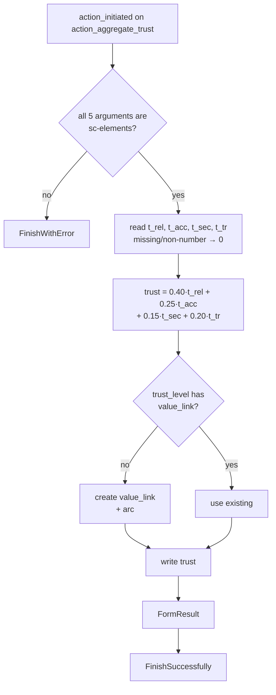

# AgentAggregateTrust

← [[Agent Index]] · aggregates [[AgentUpdateTrustReliability|t_rel]],
[[AgentUpdateTrustAccuracy|t_acc]], [[AgentUpdateTrustSecurity|t_sec]],
[[AgentUpdateTrustTransparency|t_tr]] → scalar `trust` in [[Trust Model]]

> [!note] Difference from the four other agents
> This is **not** exponential smoothing of a single indicator over time
> — it is an instantaneous recalculation of the scalar from already computed components.
> Each call **overwrites** `trust` from scratch, rather than blending it with the
> old value.

## Identification

| Field | Value |
|---|---|
| System identifier (sc-IRI) of the action class | `action_aggregate_trust` |
| Type of sc-node class | `ScType::NodeConstClass` (`sc_node_class`) |
| C++ class | `AgentAggregateTrust : public ScActionInitiatedAgent` |
| Files | `src/agent/agent_aggregate_trust.{hpp,cpp}` |
| Role | Executor of rule `rule_aggregate_trust` (π_tr) — the pipeline “collector”, final step after the four EMA agents |
| KB rule | `rules/rules_trust_update.scs` → `rule_aggregate_trust` |
| Version | commit `f05766f` |

## Purpose

**Problem.** The executor-matching function `match(σ, s)` needs **one**
scalar trust estimate, not a vector of four independent numbers —
`T(s,τ) = ⟨t_rel,t_acc,t_sec,t_tr⟩` must be folded into `trust(s,τ,h)` using
explicit, explainable weights.

**Goal.** Read the current values of all four components and compute
`trust = λ_rel·t_rel + λ_acc·t_acc + λ_sec·t_sec + λ_tr·t_tr`.

**Value.** A single aggregation point — weights are defined in one place
(expert-defined), not spread across every consumer of `trust`; when it is
necessary to change the relative importance of components (for example, raise
the security weight for critical domains), the change is made in one file, not
everywhere trust is used.

**Stakeholders:** `match(σ, s)` and everything built on it (subtask routing);
architects who set the weights `λ`; auditors who need an explainable (not
“black-box”) formula for the final score.

## Competence

**Capabilities:**
- read the current value of each of the four components (via each component’s
  `trust_level` node — find its `value_link` and parse the number);
- compute the weighted sum with fixed weights
  `λ = (0.40, 0.25, 0.15, 0.20)`, Σλ = 1;
- write the result into the `value_link` of the fifth (“output”) node,
  creating it on first access (as in the other agents);
- return `trust_level`/`value_link` in the action result.

**Limitations (by code):**
- **a missing component is silently treated as `t_k = 0`**, not as an error:
  if, for example, [[AgentUpdateTrustAccuracy]] has never been called for this
  system, `t_acc` in the formula will be 0, and this is indistinguishable from
  “a truly measured zero accuracy” — risk of lowering `trust` due to missing
  data rather than poor quality.
- the same happens if the `value_link` **exists but its content does not parse
  as a number** — `ReadFloatLinkContent` returns `false`, but the local variable
  remains `0.0f`; the error does not surface.
- it does not check that all five arguments belong to the **same** system `s`
  and context `τ` — it simply receives five addresses and trusts that the caller
  passed a consistent set.
- weights `λ` are constants in the code (`ms_lambdaRel`/`ms_lambdaAcc`/
  `ms_lambdaSec`/`ms_lambdaTr`), not an action parameter; the KB rule mentions
  “or learned” — weight learning/tuning from feedback **is not implemented**.
- it does not check `Σλ = 1` at runtime — this is an invariant maintained
  manually when choosing constants, not guaranteed programmatically.
- as with the other agents, there is no check that arguments 1–4 are actually
  `concept_trust_level` (only `IsElement`).

## Input

**Trigger:** arc `action_initiated -> <instance of action_aggregate_trust>`.

| # | Role | What | Mandatory | Validation |
|---|---|---|---|---|
| 1 | `t_rel_level` | node of component t_rel | mandatory | only `IsElement` |
| 2 | `t_acc_level` | node of component t_acc | mandatory | only `IsElement` |
| 3 | `t_sec_level` | node of component t_sec | mandatory | only `IsElement` |
| 4 | `t_tr_level` | node of component t_tr | mandatory | only `IsElement` |
| 5 | `trust_level` | receiver node for the final score | mandatory | only `IsElement` |

There are no optional parameters — all five are mandatory (although the
absence of a *value* for 1–4, unlike the absence of the node itself, is not
considered an error, see Limitations).

## Output

Updated/created sc-link `value_link` on the 5th argument (`trust_level`) with
textual content `trust`. Side effect — generation of `value_link` + connecting
arc on first call. Success — `action.FinishSuccessfully()` +
`action.FormResult(trustLevelAddr, valueLinkAddr)`.

## Links

**Dependencies:** `common/float_link_io.hpp`, `TrustKeynodes`,
`ScActionInitiatedAgent`.

**Reads:** `value_link` of each of the four argument nodes 1–4 (does not touch
or check their classification).

**Writes:** `value_link` of the fifth argument (creates if absent).

**Workflow.** The only agent in the module that depends on the results of the
other four — but it does not invoke them itself: the order “first update
t_rel/t_acc/t_sec/t_tr, then aggregate” is enforced by an **external**
orchestrator. `AgentAggregateTrust` itself knows nothing about this order and is
happy to compute `trust` even from partially “empty” (zero) components.

## Behavior

```
IF  any of the five arguments is not an sc-element
THEN  log error → action.FinishWithError()  [STOP]

ELSE
  FOR EACH k IN {t_rel_level, t_acc_level, t_sec_level, t_tr_level}:
    t_k := value of value_link of node k, IF the link exists AND parses as a number
           ELSE 0.0                      // silently, not an error

  trust := λ_rel·t_rel + λ_acc·t_acc + λ_sec·t_sec + λ_tr·t_tr

  IF  trust_level (5th argument) has no value_link
  THEN  create value_link (ConstNodeLink) + arc trust_level -> value_link

  write trust to value_link
  action.FormResult(trust_level, value_link)
  → action.FinishSuccessfully()
```



**Error handling:** the only path to error is the absence of one of the five
argument nodes; everything else (including “empty”/invalid component values)
is handled by silently replacing it with 0, without error.

**Timeouts:** as with the other four — no internal timeout, `DoProgram` is
synchronous; waiting is on the calling side (`InitiateAndWait`).

## Security

- Privileges — same as the other agents in the module: no ACL, full access to
  sc-memory within the `sc-server` process.
- **Specific risk:** because missing data is masked as “zero” rather than an
  error, `trust` can be unintentionally lowered across the board by a single
  misconfigured call (for example, if the orchestrator forgot to invoke one of
  the four EMA agents before aggregation) — and this will not be visible in the
  action status, only in the final (lowered) number.
- As with the others — there is no check that arguments 1–4 are actually
  `concept_trust_level`, and no authentication of the action initiator.
- `trust` is an abstract scalar, it does not contain PII.

## Metrics

| Metric | Value / status |
|---|---|
| Latency | Synchronous, no I/O: 4 iterators (reading components) + 1 iterator + 0–2 generations (writing the result). Slightly more expensive than the other four agents (5 nodes instead of 2), but still orders of magnitude faster than a network round-trip. |
| Accuracy | Not applicable to the formula itself (deterministic sum); correctness is verified by tests with manual calculation. The actual “usefulness” of `trust` depends entirely on the freshness of input `t_rel/t_acc/t_sec/t_tr`, which this agent does not control. |
| Cost | Negligible. |
| Alerts | Not implemented. Especially valuable would be: an alert for “suspiciously many zero components” (symptom of an inconsistent call, see Limitations) and an alert for a sharp drop in final `trust`. |

## Tests

File: `tests/test_agent_aggregate_trust.cpp` (3 tests, all pass; scenario 1
additionally verified on a live sc-server — result `0.823450`).

**1. `AggregatesFourComponentsWithDefaultWeights`**
Input: `t_rel=0.838, t_acc=0.796, t_sec=0.955, t_tr=0.730` (illustrative
example from `scenario_trust_assessment.scs`).
Output: `trust = 0.4·0.838+0.25·0.796+0.15·0.955+0.2·0.730 = 0.82345`
(rounded to “≈0.823” in the scenario), `FinishedSuccessfully`.

**2. `TreatsMissingComponentValueAsZero`**
Input: `t_rel=1, t_sec=1, t_tr=1`, and `t_acc_level` has **no** `value_link`.
Output: `trust = 0.4·1 + 0.25·0 + 0.15·1 + 0.2·1 = 0.75` — confirms the
Limitation “missing component = silent 0”, not an error.

**3. `FinishesWithErrorOnMissingArguments`**
Input: action with no arguments.
Output: `FinishedWithError`.
