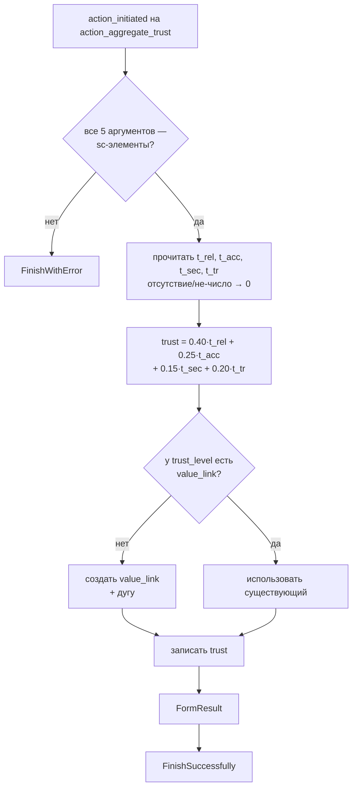

# AgentAggregateTrust

← [[00 Индекс]] · агрегирует [[AgentUpdateTrustReliability|t_rel]],
[[AgentUpdateTrustAccuracy|t_acc]], [[AgentUpdateTrustSecurity|t_sec]],
[[AgentUpdateTrustTransparency|t_tr]] → скаляр `trust` в [[Модель доверия]]

> [!note] Отличие от четырёх остальных агентов
> Это **не** экспоненциальное сглаживание одного индикатора во времени
> — это мгновенный пересчёт скаляра из уже посчитанных компонент.
> Каждый вызов **перезаписывает** `trust` заново, а не смешивает его со
> старым значением.

## Идентификация

| Поле | Значение |
|---|---|
| Системный идентификатор (sc-IRI) класса действия | `action_aggregate_trust` |
| Тип sc-узла класса | `ScType::NodeConstClass` (`sc_node_class`) |
| C++ класс | `AgentAggregateTrust : public ScActionInitiatedAgent` |
| Файлы | `src/agent/agent_aggregate_trust.{hpp,cpp}` |
| Роль | Исполнитель правила `rule_aggregate_trust` (π_tr) — «сборщик» конвейера, финальный шаг после четырёх EMA-агентов |
| Правило БЗ | `rules/rules_trust_update.scs` → `rule_aggregate_trust` |
| Версия | commit `f05766f` |

## Назначение

**Проблема.** Функции подбора исполнителя `match(σ, s)` нужна **одна**
скалярная оценка доверия, а не вектор из четырёх независимых чисел —
нужно свернуть `T(s,τ) = ⟨t_rel,t_acc,t_sec,t_tr⟩` в `trust(s,τ,h)` по
явным, объяснимым весам.

**Цель.** Прочитать текущие значения всех четырёх компонент и вычислить
`trust = λ_rel·t_rel + λ_acc·t_acc + λ_sec·t_sec + λ_tr·t_tr`.

**Ценность.** Единая точка агрегации — веса заданы в одном месте
(экспертно), а не размазаны по потребителям `trust`; при необходимости
изменить относительную важность компонент (например, поднять вес
безопасности для критичных доменов) — правка в одном файле, а не во
всех местах, где используется доверие.

**Стейкхолдеры:** `match(σ, s)` и всё, что на нём построено
(маршрутизация подзадач); архитекторы, задающие веса `λ`; аудиторы,
которым нужна объяснимая (не «чёрный ящик») формула итоговой оценки.

## Компетенция

**Capabilities:**
- прочитать текущее значение каждой из четырёх компонент (по узлу
  `trust_level` каждой — найти её `value_link` и распарсить число);
- вычислить взвешенную сумму с фиксированными весами
  `λ = (0.40, 0.25, 0.15, 0.20)`, Σλ = 1;
- записать результат в `value_link` пятого («выходного») узла,
  создав его при первом обращении (как и в остальных агентах);
- вернуть `trust_level`/`value_link` в результате действия.

**Limitations (по коду):**
- **отсутствующая компонента молча трактуется как `t_k = 0`**, а не как
  ошибка: если, например, [[AgentUpdateTrustAccuracy]] ещё ни разу не
  вызывался для данной системы, `t_acc` в формуле окажется 0, и это
  никак не отличить от «реально измеренной нулевой точности» — риск
  занизить `trust` из-за отсутствия данных, а не из-за плохого качества.
- то же самое происходит, если `value_link` **существует, но его
  содержимое не парсится как число** — `ReadFloatLinkContent` вернёт
  `false`, но локальная переменная так и останется `0.0f`; ошибка
  никак не всплывает наружу.
- не проверяет, что все пять аргументов относятся к **одной и той же**
  системе `s` и контексту `τ` — просто получает пять адресов и
  доверяет, что вызывающая сторона передала согласованный набор.
- веса `λ` — константы в коде (`ms_lambdaRel`/`ms_lambdaAcc`/
  `ms_lambdaSec`/`ms_lambdaTr`), не параметр действия; правило БЗ
  допускает «либо обучаются» — обучение/настройка весов по обратной
  связи **не реализованы**.
- не проверяет `Σλ = 1` во время выполнения — это инвариант, который
  соблюдён вручную при выборе констант, не гарантирован программно.
- как и у остальных агентов — нет проверки, что аргументы 1–4
  действительно являются `concept_trust_level` (только `IsElement`).

## Вход

**Триггер:** дуга `action_initiated -> <экземпляр action_aggregate_trust>`.

| № | Роль | Что | Обязательность | Валидация |
|---|---|---|---|---|
| 1 | `t_rel_level` | узел компоненты t_rel | обязателен | только `IsElement` |
| 2 | `t_acc_level` | узел компоненты t_acc | обязателен | только `IsElement` |
| 3 | `t_sec_level` | узел компоненты t_sec | обязателен | только `IsElement` |
| 4 | `t_tr_level` | узел компоненты t_tr | обязателен | только `IsElement` |
| 5 | `trust_level` | узел-приёмник итоговой оценки | обязателен | только `IsElement` |

Опциональных параметров нет — все пять обязательны (хотя отсутствие
*значения* у 1–4, в отличие от отсутствия самого узла, ошибкой не
считается, см. Limitations).

## Выход

Обновлённая/созданная sc-ссылка `value_link` на 5-м аргументе
(`trust_level`) с текстовым содержимым `trust`. Побочный эффект —
генерация `value_link` + связывающей дуги при первом вызове. Успех —
`action.FinishSuccessfully()` + `action.FormResult(trustLevelAddr, valueLinkAddr)`.

## Связи

**Зависимости:** `common/float_link_io.hpp`, `TrustKeynodes`,
`ScActionInitiatedAgent`.

**Читает:** `value_link` каждого из четырёх узлов-аргументов 1–4 (не
трогает и не проверяет их классификацию).

**Пишет:** `value_link` пятого аргумента (создаёт при отсутствии).

**Workflow.** Единственный агент модуля, зависящий от результатов
остальных четырёх — но не вызывающий их сам: порядок «сначала обновить
t_rel/t_acc/t_sec/t_tr, потом агрегировать» обеспечивает **внешний**
оркестратор. Сам `AgentAggregateTrust` об этом порядке ничего не знает
и с готовностью посчитает `trust` даже по частично «пустым» (нулевым)
компонентам.

## Поведение

```
IF  любой из пяти аргументов не sc-элемент
THEN  залогировать ошибку → action.FinishWithError()  [СТОП]

ELSE
  FOR EACH k IN {t_rel_level, t_acc_level, t_sec_level, t_tr_level}:
    t_k := значение value_link узла k, ЕСЛИ ссылка существует И парсится как число
           ИНАЧЕ 0.0                      // молча, не ошибка

  trust := λ_rel·t_rel + λ_acc·t_acc + λ_sec·t_sec + λ_tr·t_tr

  IF  у trust_level (5-й аргумент) нет value_link
  THEN  создать value_link (ConstNodeLink) + дугу trust_level -> value_link

  записать trust в value_link
  action.FormResult(trust_level, value_link)
  → action.FinishSuccessfully()
```



**Обработка ошибок:** единственный путь к ошибке — отсутствие одного из
пяти узлов-аргументов; всё остальное (в т.ч. «пустые»/некорректные
значения компонент) обрабатывается тихой заменой на 0, без ошибки.

**Таймауты:** как и у остальных четырёх — внутреннего таймаута нет,
`DoProgram` синхронный; ожидание на стороне вызывающего кода
(`InitiateAndWait`).

## Безопасность

- Привилегии — как у остальных агентов модуля: без ACL, полный доступ
  к sc-памяти в рамках процесса `sc-server`.
- **Специфичный риск:** поскольку отсутствие данных маскируется под
  «ноль», а не под ошибку, `trust` можно непреднамеренно занизить
  массово одним неверно настроенным вызовом (например, если
  оркестратор забыл вызвать один из четырёх EMA-агентов перед
  агрегацией) — и это не будет видно в статусе действия, только по
  итоговому (заниженному) числу.
- Как и у остальных — нет проверки, что аргументы 1–4 реально
  `concept_trust_level`, и нет аутентификации инициатора действия.
- `trust` — абстрактный скаляр, PII не содержит.

## Метрики

| Метрика | Значение / статус |
|---|---|
| Latency | Синхронно, без I/O: 4 итератора (чтение компонент) + 1 итератор + 0–2 генерации (запись результата). Немного дороже остальных четырёх агентов (5 узлов вместо 2), но по-прежнему на порядки быстрее сетевого round-trip. |
| Accuracy | Не применимо к самой формуле (детерминированная сумма); корректность проверена тестами с ручным расчётом. Фактическая «полезность» `trust` целиком зависит от актуальности входных `t_rel/t_acc/t_sec/t_tr`, которую этот агент не контролирует. |
| Cost | Пренебрежимо мал. |
| Алерты | Не реализованы. Особенно ценны были бы: алерт на «подозрительно много нулевых компонент» (симптом несогласованного вызова, см. Limitations) и алерт на резкое падение итогового `trust`. |

## Тесты

Файл: `tests/test_agent_aggregate_trust.cpp` (3 теста, все проходят; сценарий 1 дополнительно проверен на живом sc-server — получено `0.823450`).

**1. `AggregatesFourComponentsWithDefaultWeights`**
Вход: `t_rel=0.838, t_acc=0.796, t_sec=0.955, t_tr=0.730` (иллюстративный
пример из `scenario_trust_assessment.scs`).
Выход: `trust = 0.4·0.838+0.25·0.796+0.15·0.955+0.2·0.730 = 0.82345`
(в сценарии округлено до «≈0.823»), `FinishedSuccessfully`.

**2. `TreatsMissingComponentValueAsZero`**
Вход: `t_rel=1, t_sec=1, t_tr=1`, а у `t_acc_level` **нет** `value_link`.
Выход: `trust = 0.4·1 + 0.25·0 + 0.15·1 + 0.2·1 = 0.75` — подтверждает
Limitation «отсутствие компоненты = тихий 0», а не ошибку.

**3. `FinishesWithErrorOnMissingArguments`**
Вход: действие без аргументов.
Выход: `FinishedWithError`.
